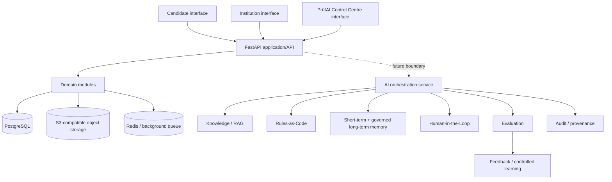

# PrüfAI Target Architecture V1

**Status:** Accepted for MVP engineering baseline
**Scope:** Architecture boundaries only; product domains are not implemented.

## Product scope

PrüfAI is a Germany-first, standards-driven examination platform. The approved German-language scope is A1, A2, B1, B2, C1, and C2. Leben in Deutschland (LiD) is a separate integration-knowledge assessment family and is not a CEFR level.

The baseline deliberately does not implement authentication, tenant business logic, exams, question banks, RAG, LLM calls, agents, scoring, assessments, HITL workflows, or candidate runtime behaviour.

## Assessment taxonomy

```text
ASSESSMENT_FAMILY
├── LANGUAGE
│   ├── language: German
│   └── CEFR: A1 | A2 | B1 | B2 | C1 | C2
└── INTEGRATION_KNOWLEDGE
    └── Leben in Deutschland (LiD)
```

LiD must not be represented as a CEFR level. Provider and institution variations will be isolated in independently versioned Standard Packs.

## Baseline architecture

The initial system is a modular monolith with separately runnable AI/background boundaries where independent scaling will eventually be useful. This keeps deployment and ownership understandable while preserving seams for later extraction.



### Frontend

`apps/web` is a minimal Next.js App Router application written in strict TypeScript. It is a presentation boundary only in this phase.

### API and domain modules

`services/api` is a FastAPI service and the initial modular-monolith boundary. Empty Python packages reserve boundaries for identity, organisations, candidates, standards, knowledge, rules, items, exams, sessions, responses, assessment, results, approvals, memory, evaluation, feedback, learning, and audit. Their business logic is intentionally deferred.

### AI service boundary

`services/ai` is independently runnable and currently exposes only health. It is the future home for orchestration, RAG, evaluation, and asynchronous assessment capabilities. No provider SDK, LangChain, LangGraph, or LLM call is included in the baseline.

### Data and infrastructure

- PostgreSQL is the system-of-record target, accessed through SQLAlchemy 2.x and Alembic. No product tables are created yet.
- pgvector is a future PostgreSQL capability for governed retrieval; it is not enabled in the baseline.
- Redis is reserved for queues, short-lived coordination, and cache-like workloads; it is not a source of truth.
- S3-compatible object storage (MinIO locally) is reserved for isolated files and media.

## Future domain boundaries

- **Standard Packs:** versioned machine-readable configurations and source bindings for CEFR, LiD, provider-aligned, and PrüfAI-owned standards.
- **Knowledge/RAG:** controlled ingestion, provenance, retrieval, and citation boundary; retrieval is not a substitute for executable rules.
- **Rules-as-Code:** deterministic constraints, eligibility, timing, scoring, and validation rules.
- **Agent orchestration:** agents propose work under explicit tools and policy; they do not become an uncontrolled source of truth.
- **Memory:** short-term execution state and governed long-term memory with tenant and purpose boundaries.
- **HITL:** explicit review, approval, rejection, and escalation states for governed operations.
- **Evaluation:** RAGAS and custom evaluations later, with reproducible datasets and model/prompt provenance.
- **Feedback/Learning:** controlled improvement loops that preserve evidence and approval boundaries.
- **Audit/Provenance:** append-oriented records of important changes, decisions, inputs, outputs, versions, and approvals.

## Versioning principle

The following will eventually be versioned: Standard Packs, rules, rubrics, questions, exams, prompts, agents, models, memory, and assessment configurations. Published exam and question versions are immutable. The baseline does not create all corresponding tables yet.

## Security principles

The architecture must enforce tenant isolation, least privilege, RBAC with future ABAC where necessary, privileged-user MFA, EU-region deployment, encryption in transit and at rest, managed secrets, append-oriented audit events, object-storage isolation, no cross-tenant AI memory, and no cross-tenant RAG retrieval unless explicitly public/shared. These are design requirements, not implemented controls in this phase.

## Governing principle

> Knowledge grounds.
> Rules constrain.
> Agents propose.
> Humans govern.
> Memory retains.
> Feedback teaches.
> Evaluation proves.
> Versions improve.
> Audit remembers.
